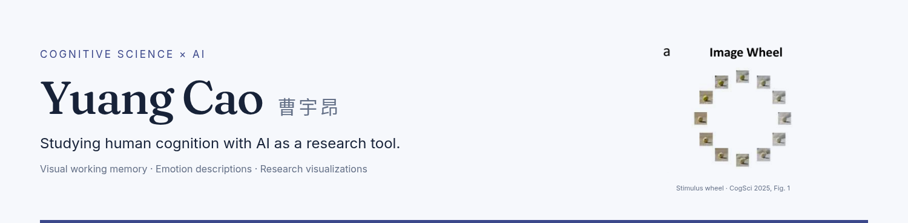

I am an undergraduate in **Intelligent Medical Engineering at SUSTech**, working at the intersection of cognitive science and AI.

My research experience includes visual working memory, controllable visual stimuli, and the evaluation of emotion descriptions. I use this space to share published work and source-linked research visualizations.

[Academic homepage](https://anmicky.github.io/) · [中文 / English](https://anmicky.github.io/) · [Email](mailto:12310901@mail.sustech.edu.cn)

## Selected work

| Work | What you can explore | Links |
| --- | --- | --- |
| **Visual working memory** · CogSci 2025 | *Dimensions of Vulnerability in Visual Working Memory: An AI-Driven Approach to Perceptual Comparison*. Co-first-author paper on memory distortions following perceptual comparison. | [Paper](https://anmicky.github.io/paper/CogSci2025_Dimensions_of_Vulnerability_in_VWM.pdf) · [Publication repository](https://github.com/Anmicky/Dimensions-of-Vulnerability-in-Visual-Working-Memory) |
| **Emo-FilM reading map** · Interactive note | Explore all 50 retained measurement items, their scale endpoints, and how subsequent studies selected data and interpreted results. This is a literature visualization, not a new empirical finding. | [Open the interactive map](https://anmicky.github.io/emofilm/) · [Item atlas](https://anmicky.github.io/emofilm/reference.html#atlas) |

## Current interests

- **Memory and perception:** how visual representations change through comparison and recall.
- **Emotion descriptions:** how model-generated descriptions relate to human reports and judgments.
- **Research communication:** making measurement choices, evidence, and interpretation limits easier to inspect.

The publication repository currently contains the paper and its summary. Code, stimuli, and participant-level data are not included there. Forked repositories are study resources; authorship and attribution remain with their original projects.

Figure excerpt: Cao, Zou, Wei & Liu, CogSci 2025, Figure 1. Profile updated 21 October 2026.
